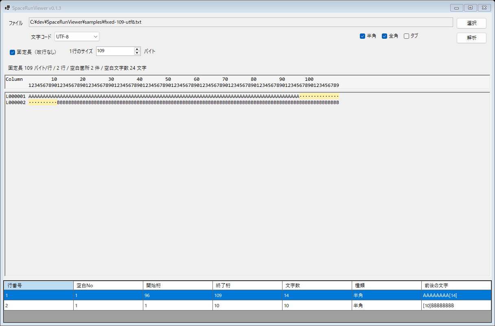

# SpaceRunViewer

SpaceRunViewer は、テキストファイル内の連続した空白部分を検出して、開始桁と文字数を確認するための Windows 用ツールです。

固定長テキストのレイアウト確認で、空白部分を手作業で選択して桁位置や文字数を数える作業を減らすことを目的にしています。

## バージョンと固定長対応

| 提供形態 | バージョン | 固定長ファイルの解析 |
| --- | --- | --- |
| このリポジトリの最新ソース（main） | v0.1.3 | 対応。画面で1行のバイト数を指定できます。 |
| GitHub Releases の公開配布版 | v0.1.3 | 対応。Windows x64 向けの実行ファイルをダウンロードできます。 |

固定長対応は v0.1.3 で追加しました。v0.1.2 以前を利用している場合は、下記の配布版に更新してください。

## 主な機能

- テキストファイルを読み込み
- 半角スペース、全角スペース、タブを対象として選択可能
- 連続した空白を1つの空白ブロックとして検出
- 本文上で空白部分を色付き表示
- 桁位置が分かるルーラー表示
- 空白ブロックごとに一覧表示
  - 行番号
  - 空白No
  - 開始桁
  - 終了桁
  - 文字数
  - 種類
  - 前後の文字
- 一覧の行を選択すると、本文側の該当空白を強調
- Shift_JIS / UTF-8 に対応
- 改行なしの固定長ファイルは、1行のサイズをバイト数で指定して解析可能

## 画面イメージ



## ダウンロード

**v0.1.3（1行のバイト数指定に対応）** は [GitHub Releases](https://github.com/konikatsu/SpaceRunViewer/releases/tag/v0.1.3) からダウンロードできます。

[SpaceRunViewer-v0.1.3-win-x64.zip をダウンロード](https://github.com/konikatsu/SpaceRunViewer/releases/download/v0.1.3/SpaceRunViewer-v0.1.3-win-x64.zip)

zip を展開して、`SpaceRunViewer.exe` を起動してください。固定長ファイルを解析するときは、`固定長（改行なし）` をオンにして、`1行のサイズ` にバイト数を入力します。

この配布版は Windows x64 向けで、.NET ランタイムを同梱しています。配布先へ .NET を別途インストールする必要はありません。`samples` フォルダーには動作確認用のサンプルを同梱しています。

## 使い方

1. ファイルを選択します。
2. 文字コードを選択します。
3. 対象にする空白種類を選択します。
4. `解析` ボタンを押します。
5. 下段の一覧で、空白の開始桁と文字数を確認します。

### 改行なしの固定長ファイル

**v0.1.3 以降で利用できます。** 改行なしのファイルを、指定したバイト数ごとに1行として解析します。

1. ファイルと文字コードを選択します。
2. `固定長（改行なし）` をオンにします。
3. `1行のサイズ` に1レコードのバイト数を入力します（1〜1,000,000 バイト、初期値：`109`）。
4. `解析` を押すと、指定バイト数ごとに行を区切って表示・解析します。元のファイルには改行を追加しません。

例えば `109` を指定すると、先頭の109バイトが1行目、次の109バイトが2行目になります。1行目の末尾と2行目の先頭に空白が連続していても、行ごとに別の空白ブロックとして解析します。

UTF-8のBOMはレコードのバイト数に含めません。末尾が指定サイズに満たない場合は、残りも最後の行として表示し、上部にそのバイト数を表示します。文字の途中にレコード境界が入る場合は、文字化けした内容を表示せず、サイズと文字コードの確認を案内します。

`samples/fixed-109-utf8.txt` は、109バイト×2件・改行なし・UTF-8/BOMなしのサンプルです。1件目の末尾空白14文字と2件目の先頭空白10文字を、別々の空白ブロックとして確認できます。

指定する行サイズはバイト数です。空白一覧の開始桁・終了桁・文字数は従来どおり文字単位です。改行があるファイルは、固定長をオフにして従来の方法で解析します。

## 開発者向け

ビルドには Windows と .NET 8 SDK が必要です。実行用の .NET 8 Desktop Runtime だけではビルドできません。

### ビルド

```powershell
dotnet build .\SpaceRunViewer.csproj
```

### 実行

```powershell
dotnet run --project .\SpaceRunViewer.csproj
```

### Windows x64向けの配布版を作成

```powershell
dotnet publish .\SpaceRunViewer.csproj -c Release -r win-x64 --self-contained true -p:PublishSingleFile=true -p:IncludeNativeLibrariesForSelfExtract=true -p:EnableCompressionInSingleFile=true -o .\publish\SpaceRunViewer-v0.1.3-win-x64
```

この方法で作る実行ファイルは.NETランタイムを含むため、配布先へ.NETを別途インストールせずに起動できます。

### テスト

```powershell
dotnet run --project .\tests\SpaceRunViewer.Tests\SpaceRunViewer.Tests.csproj
```
